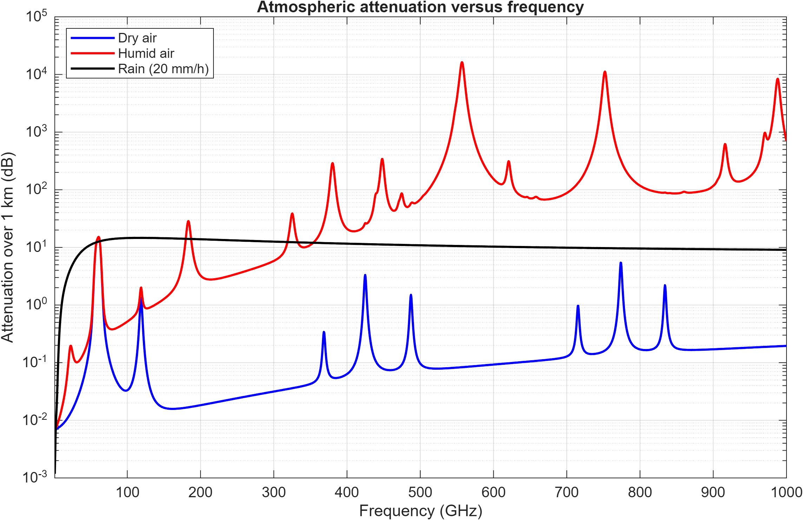
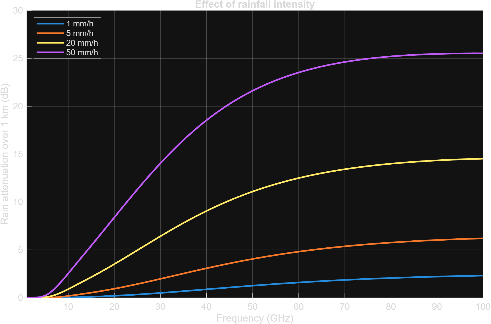
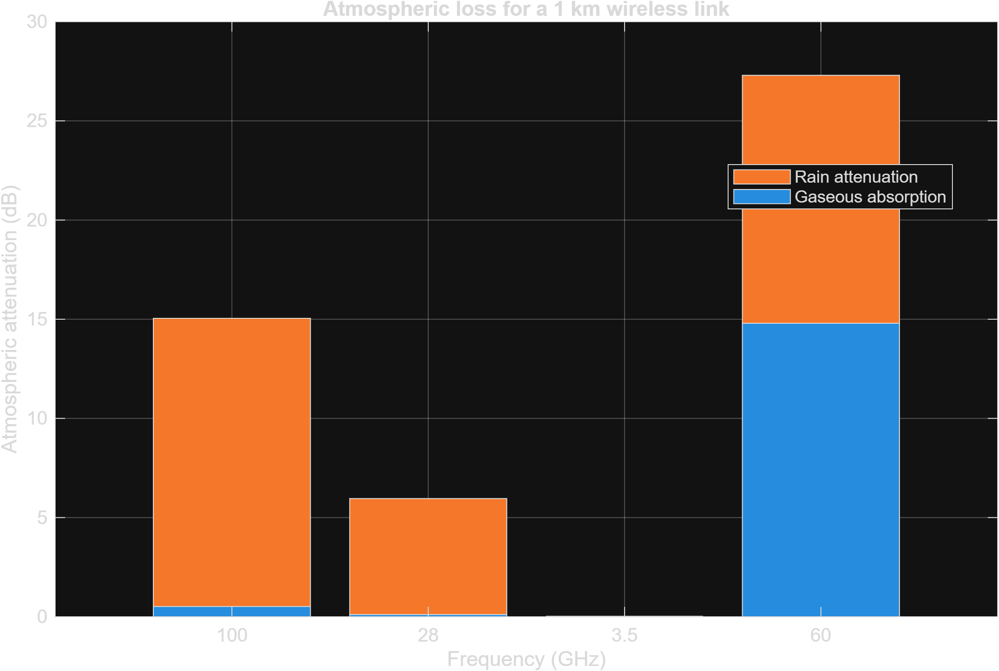
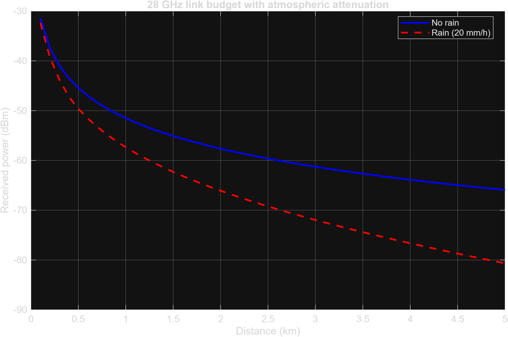

# Atmospheric Attenuation in Wireless Communication Systems

## Overview

This project investigates the influence of atmospheric gases and rainfall on
electromagnetic wave propagation in microwave and millimeter-wave wireless
communication systems.

Using MATLAB and International Telecommunication Union (ITU-R) propagation
models, four numerical experiments are performed to analyze:

1. Frequency-dependent atmospheric absorption.
2. Rain attenuation under different rainfall intensities.
3. Atmospheric losses at selected wireless communication frequencies.
4. Received signal power over distance under clear and rainy conditions.

The simulations are relevant to radio-link design, 5G millimeter-wave
communications, wireless backhaul, and emerging 6G systems.

## Simulation Environment

**Software:** MATLAB

**Required toolbox:** Phased Array System Toolbox

**Main functions:**

- `gaspl()` — Atmospheric gaseous absorption.
- `rainpl()` — Rain-induced path attenuation.
- `plot()`, `semilogy()`, and `bar()` — Data visualization.

The project uses propagation models based on ITU-R P.676 and ITU-R P.838.

---

# 1. Atmospheric Attenuation vs. Frequency

**Source:** `matlab/atmospheric_attenuation.m`

## Objective

To investigate the frequency-dependent attenuation of electromagnetic waves
caused by atmospheric oxygen, water vapor, and rainfall over a 1 km path.

## Simulation Parameters

| Parameter | Value |
|---|---|
| Frequency range | 1–1000 GHz |
| Propagation distance | 1 km |
| Temperature | 15 °C |
| Dry-air pressure | 101300 Pa |
| Water vapor density | 7.5 g/m³ |
| Rainfall intensity | 20 mm/h |

## Results



*Figure 1. Gaseous absorption in dry and humid air compared with
rain attenuation for a 1 km propagation path.*

## Discussion

### Dry-Air Absorption

The blue curve represents atmospheric attenuation in the absence
of water vapor.

Most of the absorption arises from molecular oxygen.

The curve exhibits distinct resonance features associated with
oxygen absorption lines.

A particularly important absorption region occurs near 60 GHz.

Additional oxygen absorption features occur at higher frequencies,
including around 118 GHz and 760 GHz.

Between absorption lines, dry-air attenuation may be comparatively low.

### Humid-Air Absorption

The red curve represents gaseous attenuation in an atmosphere
containing water vapor.

Water vapor introduces additional molecular absorption lines,
including prominent features around:

- 22 GHz
- 183 GHz
- 325 GHz
- 380 GHz
- 448 GHz
- 557 GHz
- 752 GHz

The magnitude of these absorption features depends on frequency
and atmospheric conditions.

The humid-air curve is generally above the dry-air curve because
water vapor contributes additional absorption.

### Rain Attenuation

The black curve represents attenuation due to rainfall at 20 mm/h.

Unlike the gaseous absorption curves, rain attenuation does not
exhibit the same narrow molecular absorption lines.

Rain attenuation is associated with absorption and scattering
by liquid water droplets.

In the simulated model, attenuation increases strongly at lower
microwave frequencies before approaching a comparatively gradual
variation at higher frequencies.

### Physical Interpretation

Atmospheric attenuation is strongly frequency selective.

Some frequencies lie near strong molecular absorption bands,
while others lie within relatively transparent propagation windows.

Consequently, atmospheric attenuation is not a monotonically
increasing function of frequency.

This behavior has important implications for selecting carrier
frequencies in wireless communication systems.

**Engineering implication:** Operating frequencies must be selected
with consideration of both atmospheric absorption and the required
communication distance.

---

# 2. Rain Attenuation vs. Rainfall Intensity

**Source:** `matlab/rain_attenuation.m`

## Objective

To investigate how rainfall intensity affects electromagnetic wave
propagation across microwave and millimeter-wave frequencies.

## Simulation Parameters

| Parameter | Value |
|---|---|
| Frequency range | 1–100 GHz |
| Propagation distance | 1 km |
| Rainfall intensities | 1, 5, 20, 50 mm/h |
| Propagation environment | Uniform rainfall |

## Results



*Figure 2. Rain attenuation as a function of carrier frequency
for four different rainfall intensities.*

## Mathematical Model

Specific rain attenuation can be expressed using the ITU-R
power-law relationship:

$$
\gamma_R = kR^\alpha
$$

where:

- $\gamma_R$ is specific attenuation in dB/km.
- $R$ is the rainfall rate in mm/h.
- $k$ and $\alpha$ are coefficients dependent on frequency,
  polarization, and propagation geometry.

For a homogeneous rain region:

$$
L_R = \gamma_R d
$$

where $d$ is the path length in kilometers.

## Discussion

### Influence of Rainfall Intensity

The simulation demonstrates that increasing rainfall intensity
produces greater signal attenuation.

For a fixed frequency, the 50 mm/h curve experiences the largest
loss, while the 1 mm/h curve experiences the smallest.

This occurs because a higher rainfall rate corresponds to a
greater quantity of liquid water interacting with the propagating
electromagnetic wave.

### Influence of Frequency

All four curves show a strong frequency dependence.

At relatively low frequencies, rain attenuation is small.

As frequency increases into the millimeter-wave region,
attenuation becomes considerably more significant.

For example, around 50 GHz, the graph indicates approximately:

- 1 mm/h: 1 dB over 1 km.
- 5 mm/h: 4 dB over 1 km.
- 20 mm/h: 11 dB over 1 km.
- 50 mm/h: 22 dB over 1 km.

These values are approximate readings from the plotted curves.

### High-Frequency Behavior

At higher frequencies, the modeled attenuation curves begin
to flatten.

This reflects the frequency dependence of the effective
interaction between electromagnetic waves and raindrops.

The exact behavior depends on the rain model, drop-size
distribution, polarization, and propagation geometry.

### Engineering Interpretation

Rainfall can substantially reduce the received signal power
of high-frequency wireless links.

For systems operating at millimeter-wave frequencies,
rain-induced attenuation may require:

- Additional link fade margins.
- Shorter communication distances.
- Higher antenna gains.
- Adaptive modulation and coding.
- Alternative communication paths or frequencies.

**Engineering implication:** Wireless link reliability must
be evaluated under different rainfall conditions rather than
considering clear-sky propagation alone.

---

# 3. Atmospheric Loss Comparison at Selected Frequencies

**Source:** `matlab/frequency_comparison.m`

## Objective

To compare the relative contributions of gaseous absorption
and rainfall to total atmospheric attenuation at selected
wireless communication frequencies.

## Simulation Parameters

| Parameter | Value |
|---|---|
| Frequencies | 3.5, 28, 60, 100 GHz |
| Propagation distance | 1 km |
| Temperature | 15 °C |
| Dry-air pressure | 101300 Pa |
| Water vapor density | 7.5 g/m³ |
| Rainfall intensity | 20 mm/h |

## Results



*Figure 3. Stacked atmospheric attenuation components
at 3.5, 28, 60, and 100 GHz over a 1 km path.*

## Mathematical Model

The total attenuation is approximated by:

$$
L_{\mathrm{total}} =
L_{\mathrm{gas}} + L_{\mathrm{rain}}
$$

where:

- $L_{\mathrm{gas}}$ represents gaseous absorption.
- $L_{\mathrm{rain}}$ represents rain-induced attenuation.

Because both quantities are expressed in decibels,
their contributions can be added.

## Discussion

### 3.5 GHz

The atmospheric loss at 3.5 GHz is very small under
the simulated conditions.

Both gaseous absorption and rain attenuation contribute
relatively little additional loss over 1 km.

This is one reason lower microwave frequencies are
generally less sensitive to atmospheric conditions
than millimeter-wave frequencies.

### 28 GHz

At 28 GHz, the graph indicates a total atmospheric
attenuation of approximately 6 dB.

Most of this loss is attributable to rainfall rather
than gaseous absorption.

This illustrates the importance of rain-fade margins
for millimeter-wave wireless links.

### 60 GHz

At 60 GHz, the total atmospheric attenuation reaches
approximately 27 dB over 1 km.

The gaseous absorption component is approximately
15 dB, with rainfall contributing additional loss.

This occurs because 60 GHz lies within a strong
oxygen absorption band.

Therefore, 60 GHz can experience significantly greater
atmospheric loss than nearby frequencies.

### 100 GHz

At 100 GHz, total attenuation is approximately
15 dB over the simulated path.

Rain attenuation dominates the total loss,
while gaseous absorption contributes comparatively little.

Despite its higher carrier frequency, the total atmospheric
loss is lower than at 60 GHz under the specified conditions.

### Key Observation

**Higher frequency does not necessarily imply higher
atmospheric gaseous attenuation.**

Molecular absorption produces frequency-selective
attenuation peaks.

As a result, a 60 GHz signal may experience greater
atmospheric attenuation than a 100 GHz signal.

### Engineering Interpretation

The results demonstrate the importance of selecting
communication frequencies according to:

- Atmospheric propagation characteristics.
- Required coverage distance.
- Weather conditions.
- Available bandwidth.
- Antenna and hardware capabilities.

Frequency selection represents a trade-off between
bandwidth availability, propagation loss, and system reliability.

---

# 4. Wireless Link Budget Under Clear and Rainy Conditions

**Source:** `matlab/wireless_link_budget.m`

## Objective

To evaluate how propagation distance and rainfall affect
the received signal power of a 28 GHz wireless link.

## Simulation Parameters

| Parameter | Value |
|---|---|
| Carrier frequency | 28 GHz |
| Transmitted power | 30 dBm |
| Transmit antenna gain | 20 dBi |
| Receive antenna gain | 20 dBi |
| Distance range | 100 m–5 km |
| Rainfall intensity | 20 mm/h |

## Results



*Figure 4. Received power versus propagation distance
for a 28 GHz line-of-sight wireless link under clear
and rainy atmospheric conditions.*

## Mathematical Model

The received power is determined using a simplified
wireless link budget:

$$
P_r =
P_t + G_t + G_r
- L_{\mathrm{FSPL}}
- L_{\mathrm{gas}}
- L_{\mathrm{rain}}
$$

where:

- $P_r$ is received power in dBm.
- $P_t$ is transmitted power in dBm.
- $G_t$ is transmitter antenna gain in dBi.
- $G_r$ is receiver antenna gain in dBi.
- $L_{\mathrm{FSPL}}$ is free-space path loss in dB.
- $L_{\mathrm{gas}}$ is gaseous attenuation in dB.
- $L_{\mathrm{rain}}$ is rain attenuation in dB.

Free-space path loss is calculated as:

$$
L_{\mathrm{FSPL}} =
20\log_{10}
\left(\frac{4\pi df}{c}\right)
$$

where:

- $d$ is propagation distance in meters.
- $f$ is carrier frequency in Hz.
- $c$ is the speed of light in m/s.

## Discussion

### Received Power vs. Distance

Both curves show decreasing received power as
the propagation distance increases.

The decrease is primarily associated with free-space
path loss, combined with atmospheric absorption.

Under free-space conditions, received power decreases
with the square of distance.

In decibels, free-space path loss increases logarithmically
with distance.

### Clear Atmospheric Conditions

The blue curve represents propagation without rainfall,
while still accounting for gaseous absorption.

The simulated received power decreases from approximately
-31 dBm at 100 m to around -66 dBm at 5 km.

These are approximate values read from the figure.

### Rainy Atmospheric Conditions

The red dashed curve includes additional attenuation
caused by rainfall at 20 mm/h.

The rainy curve remains below the clear-atmosphere curve
throughout the simulated distance range.

At approximately 5 km, the rainy-condition received
power is around -81 dBm.

### Increasing Difference Between Curves

The difference between clear and rainy conditions
increases with distance.

This occurs because rain attenuation accumulates
along the propagation path.

For homogeneous rainfall:

$$
L_R = \gamma_R d
$$

Therefore, rain-induced attenuation grows linearly
with distance when expressed in decibels.

### Engineering Interpretation

This result highlights the importance of atmospheric
conditions when designing millimeter-wave wireless links.

A communication link that performs adequately under
clear conditions may experience substantially lower
received power during heavy rainfall.

Possible mitigation strategies include:

- Increasing antenna gain.
- Reducing the link distance.
- Introducing additional fade margin.
- Using adaptive modulation and coding.
- Employing frequency diversity.
- Using alternative communication routes.

**Engineering implication:** The achievable coverage
distance depends not only on transmit power and antenna
gain but also on atmospheric attenuation and the receiver's
required sensitivity or signal-to-noise ratio.

---

# 5. Overall Discussion

The four simulations collectively demonstrate several
important properties of wireless propagation.

## 5.1 Frequency-Selective Atmospheric Absorption

Atmospheric gases introduce absorption peaks associated
with molecular resonances.

Consequently, gaseous attenuation varies non-monotonically
with carrier frequency.

## 5.2 Rain-Induced Propagation Loss

Rain attenuation increases with rainfall intensity
and depends strongly on carrier frequency.

It is particularly important for millimeter-wave
communication systems.

## 5.3 Atmospheric Propagation Windows

Certain frequency regions exhibit relatively low
gaseous attenuation compared with strong absorption bands.

These regions may be favorable for longer-distance links,
subject to other system constraints.

## 5.4 Propagation Distance

Atmospheric losses accumulate over distance.

Even moderate specific attenuation can become significant
over longer wireless paths.

## 5.5 Implications for 5G and 6G

High-frequency communication systems can provide access
to large bandwidths.

However, atmospheric absorption and rain attenuation
introduce additional propagation challenges.

Reliable network design requires balancing:

- Carrier frequency.
- Coverage distance.
- Antenna gain.
- Weather-dependent losses.
- Receiver sensitivity.
- Communication reliability.

---

# 6. Model Assumptions and Limitations

The simulations use simplified propagation environments.

The main assumptions are:

1. Homogeneous atmospheric conditions.
2. Constant temperature and pressure along the path.
3. Uniform rainfall intensity.
4. Line-of-sight propagation.
5. Constant antenna gains.
6. No explicit modeling of buildings or other obstacles.

Additional physical effects not modeled include:

- Multipath propagation.
- Shadow fading.
- Small-scale fading.
- Diffraction.
- Building penetration loss.
- Interference.
- Hardware losses.
- Spatially varying rainfall.

The results therefore represent model-based propagation
studies rather than measurements from an operational
wireless communication network.

The selected rain rates are model inputs and should
not be interpreted as actual measured weather conditions.

---

# 7. Future Work

Potential extensions of this project include:

1. Evaluating atmospheric attenuation under different
   temperature, pressure, and humidity conditions.

2. Investigating horizontal and vertical polarization
   effects on rain attenuation.

3. Comparing different millimeter-wave carrier frequencies.

4. Analyzing atmospheric attenuation together with
   antenna beamforming and directional gain.

5. Investigating fade margin and communication availability.

6. Exploring realistic propagation scenarios using
   ray tracing and geographic information.

7. Developing interactive Python notebooks to visualize
   frequency-dependent and weather-dependent link performance.

---

# 8. References

1. International Telecommunication Union,
   **ITU-R P.676: Attenuation by Atmospheric Gases
   and Related Effects**.

   https://www.itu.int/rec/R-REC-P.676/en

2. International Telecommunication Union,
   **ITU-R P.838: Specific Attenuation Model for Rain
   for Use in Prediction Methods**.

   https://www.itu.int/rec/R-REC-P.838/en

3. International Telecommunication Union,
   **ITU-R P.530: Propagation Data and Prediction Methods
   for Terrestrial Line-of-Sight Systems**.

   https://www.itu.int/rec/R-REC-P.530/en

4. MathWorks,
   **gaspl — RF Signal Attenuation Due to Atmospheric
   Gaseous Absorption**.

   https://www.mathworks.com/help/phased/ref/gaspl.html

5. MathWorks,
   **rainpl — RF Signal Attenuation Due to Rainfall**.

   https://www.mathworks.com/help/phased/ref/rainpl.html

---

# 9. Project Structure

```text
01-atmospheric-attenuation/
├── README.md
├── matlab/
│   ├── atmospheric_attenuation.m
│   ├── rain_attenuation.m
│   ├── frequency_comparison.m
│   └── wireless_link_budget.m
├── figures/
│   ├── atmospheric_attenuation.png
│   ├── rain_attenuation.png
│   ├── frequency_comparison.png
│   └── wireless_link_budget.png
└── notebooks/
```

## Conclusion

The simulations demonstrate that atmospheric propagation
effects play an important role in the performance of
high-frequency wireless communication systems.

The combined influence of oxygen absorption, water vapor,
rainfall, and propagation distance must be considered
when designing reliable microwave and millimeter-wave links.

The results provide a foundation for further investigation
of wireless link budgets, channel propagation, and
high-frequency communication system optimization.
